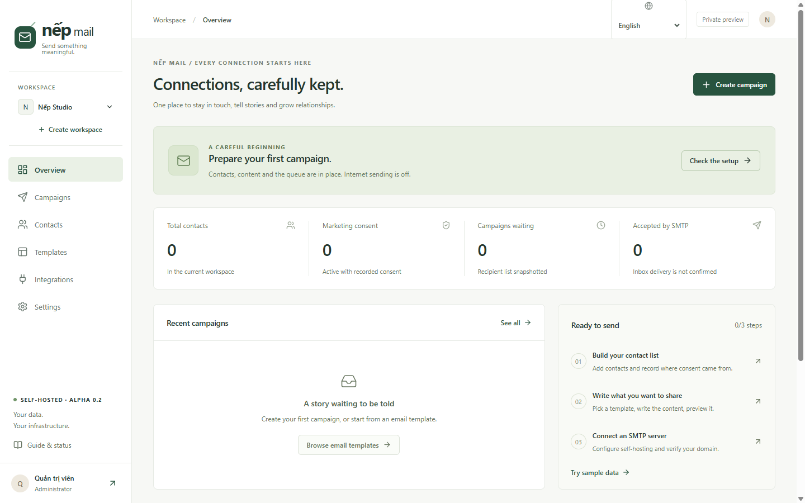
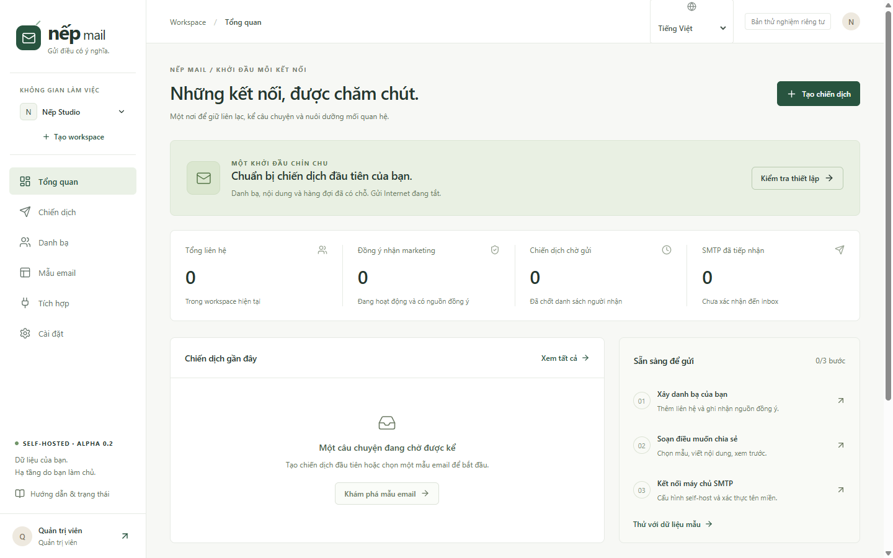

# Nếp Mail

**Gửi điều có ý nghĩa.** A self-hosted email campaign tool for people who would
rather own their list than rent an audience.

[](LICENSE)
[](#languages)
[](#development)
[](#status)
[](docs/SPONSOR.md)

No Mailchimp, SendGrid, Mailgun or SES account. You run Postfix (or any SMTP
relay) and keep the contacts in a SQLite file you can copy. Software is free; a
domain, a server, a sending IP and the time to warm it up are not.

## Why this exists

Most email tools assume a marketing team, a monthly subscription and a vendor
holding your audience. Nếp Mail assumes the opposite: a small team, a list they
built themselves, and an obligation to prove where every address came from.

What that means in practice:

- **Consent is a first-class record** — every contact stores its source and the
  time it was confirmed. Marketing email only goes to contacts with that record,
  and imports never resurrect an unsubscribe.
- **Double opt-in is built in** — a public form, a confirmation email and a
  signed, single-use link. The contact stays `pending` until they click.
- **No tracking pixels, no link rewriting** — nothing phones home from the
  recipient's inbox. You get SMTP acceptance, not surveillance.
- **Bounces suppress themselves** — hard failures and complaints are ingested and
  blocked before they cost you a domain.

## Screens



<sub>The same workspace in Vietnamese — the interface language is a per-browser
preference, while each campaign keeps its own email language.</sub>



## What works

- Vietnamese-first dashboard, ten interface languages, isolated workspaces,
  admin/editor/viewer checks in the shared core.
- Contacts, tags, consent provenance, CSV validation/deduplication and
  persistent suppression.
- **Public signup forms with double opt-in**: hosted page, honeypot, rate limit,
  signed 48-hour confirmation link, `pending → active` transition, no account
  needed for the subscriber.
- Four starter templates in Vietnamese and English; personalized plain-text
  composer; escaped HTML + text rendering; desktop/mobile preview and HTML
  export.
- Audience preflight, recipient snapshots, scheduled queueing, cancellation and
  conditional delivery claims.
- Self-host worker; local SMTP capture; opt-in direct SMTP with DKIM signing and
  one-click unsubscribe headers.
- **Domain readiness checks** (SPF, DKIM, DMARC, MX over DNS-over-HTTPS) and an
  **in-app DKIM key generator** that never stores the private key.
- **Bounce and complaint ingestion** from raw DSN/ARF messages, a provider
  webhook, or directly over IMAP, with automatic suppression.
- **HTTP relay adapter** for people without port 25: send through Brevo's API and
  receive bounces by webhook — no MTA, no mailbox, no IMAP.
- Signed unsubscribe links, confirmation on GET and opt-out on POST; suppression
  rechecked before SMTP handoff.
- Workspace integration tokens stored hashed; idempotent Nếp HR / Nếp Business
  contact events; key revocation and audit history.
- SQLite persistence/migrations, session auth, CSRF origin checks, login
  throttling, 46 automated core/HTTP/SMTP/i18n/IMAP/relay tests.

## Keep it free

This is not a product with a free tier — there is one tier, and it is all of it.
No per-contact pricing, no "upgrade to send 5,000 emails", no feature held behind
a licence key. That only stays true while someone has the evenings to spend on it.

If Nếp Mail replaced something you were paying for, you can send a little back:
**♥ [Sponsor or donate](docs/SPONSOR.md)** — GitHub Sponsors, Ko-fi, or a VietQR
bank transfer. The page lists exactly what the money covers and what it does not
buy (no priority support, no roadmap votes).

If you would rather not pay, the useful free things are: star the repository,
report a bug with the version from `/healthz`, or fix a translation in
`src/core/locales/`.

## Quickstart (Docker)

```sh
git clone <this repository> nep-mail && cd nep-mail
node scripts/setup.mjs        # writes .env with independent random secrets
docker compose up -d --build  # app on :3000, Mailpit on :8025
```

Open <http://localhost:3000>, sign in with the `ADMIN_PASSWORD` generated in
`.env`, and open the capture inbox at <http://localhost:8025>. The default stack
sends only to that local inbox; nothing reaches the Internet until you opt in.

### Without Docker

Node 24.19+ and pnpm 11.25:

```sh
corepack enable
pnpm install --frozen-lockfile
node scripts/setup.mjs
pnpm build:selfhost
pnpm start:selfhost
```

Windows users can run `.\Start-NepMail.ps1` with Docker Desktop in Linux
container mode.

## Languages

Tiếng Việt · English · Español · Português (Brasil) · Français · Deutsch ·
Русский · 日本語 · 한국어 · 简体中文

Dates and numbers use `Intl` with the active locale, API validation errors and
delivery-readiness reasons follow `Accept-Language`, and every campaign stores
its own email language — used for the message chrome and the public unsubscribe
page, so a recipient who never opens the app still sees their language.
Untranslated strings fall back to English, then Vietnamese. Adding a language is
one file plus one registry entry: see [docs/I18N.md](docs/I18N.md).

## Deliverability

Read [docs/DELIVERABILITY.md](docs/DELIVERABILITY.md) before enabling live
sending: domain checks, DKIM key publishing, and how bounces reach the
suppression list. The built-in checks tell you what DNS says; they cannot promise
an inbox.

## API

Workspace API keys (`nep_…`, shown once, stored as a SHA-256 digest) cover two
server-to-server surfaces:

```sh
# contact event from another app; idempotent on `id`
curl -sS $ORIGIN/api/v1/events -H "authorization: Bearer nep_…" \
  -H "content-type: application/json" \
  -d '{"id":"evt_1","type":"contact.upsert","contact":{"email":"a@b.vn","name":"An"}}'

# bounce or complaint: raw message or parsed event
curl -sS $ORIGIN/api/v1/bounces -H "authorization: Bearer nep_…" \
  -H "content-type: application/json" \
  -d '{"email":"gone@b.vn","kind":"hard","diagnostic":"550 5.1.1"}'
```

Integration keys can move contacts and suppress addresses; they can never grant
marketing consent, change members or send a campaign.

## Architecture

`src/core` owns business rules, validation, rendering and API handlers behind a
small database/transport interface. `selfhost` adapts the core to Node HTTP,
SQLite and SMTP. `src/ui` is the shared React interface. `ops/postfix` is direct
delivery infrastructure, not a paid relay.

The application snapshots intended recipients at queue time and uses an atomic
state claim before SMTP submission. It does **not** promise exactly-once external
delivery; ambiguous outcomes are held for reconciliation, and accepted counts
mean SMTP acceptance, never confirmed inbox delivery.

## Status

`0.3.0-alpha.4` — a working private pilot. Read the
[test and release report](docs/TEST-REPORT.md) before trusting it with a real
list. Remaining gates include live SMTP/DNS/PTR validation on an owned domain, a
warm-up run, an upload/restore drill and an independent security review.

## Development

```sh
pnpm install --frozen-lockfile
node scripts/setup.mjs
pnpm build:selfhost && pnpm test && pnpm typecheck && pnpm format:check
```

Tests use isolated temporary databases and a loopback SMTP capture fixture; no
real mail leaves the machine. More detail in [CONTRIBUTING.md](CONTRIBUTING.md)
and [docs/RELEASE.md](docs/RELEASE.md).

## Read next

[Self-host guide](docs/SELF_HOST.md) · [Deliverability](docs/DELIVERABILITY.md) ·
[Localisation](docs/I18N.md) · [Product contract](docs/01-BA.md) ·
[Design & architecture](docs/02-DESIGN.md) ·
[Integration contract](docs/INTEGRATIONS.md) ·
[Test and release status](docs/TEST-REPORT.md) · [Launch kit](docs/LAUNCH.md) ·
[Security](SECURITY.md)

## License

GNU Affero General Public License v3.0 or later — see [LICENSE](LICENSE) and
[NOTICE](NOTICE).

AGPL was chosen deliberately: you can self-host, modify and even sell services
built on Nếp Mail, but if you run a modified version for other people, they must
be able to get that source. It keeps a hosted copy from becoming a closed
competitor to the project it forked.

No Keila code is included; Nếp Mail is an independent implementation. Postfix and
Mailpit run as separate containers under their own licences — see
[THIRD_PARTY.md](THIRD_PARTY.md).
